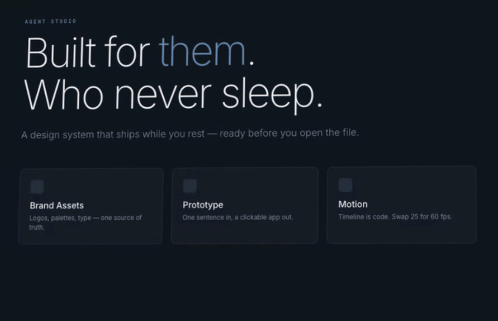

# Commented Bible — Digital Bible Study & Handwriting Journal (`vos-escrevo`)

A digital replica of a handwritten Bible study journal designed for **iPad + Apple Pencil** and desktop browsers, crafted with a **Modern Studio & Archival Editorial** aesthetic in both **Dark Mode** and **Light Mode**.

Each authenticated user owns a private study journal. Selecting a Bible book and chapter opens a two-page hardbound book spread:
- **Left Page (Scripture / Pericope)**: Read-only Scripture text from the *Bíblia Livre (BLIVRE)* translation rendered in **Newsreader** serif typography, where you can underline and highlight verses using pastel markers or fountain-pen inks.
- **Right Page (Personal Commentary)**: An adaptive dot-grid journal page paired 1:1 with the chapter, featuring a manuscript date stamp (`Data:`) and a freehand vector canvas for personal reflections.



---

## Table of Contents

1. [Key Features](#1-key-features)
2. [Architecture & Tech Stack](#2-architecture--tech-stack)
3. [Project Structure](#3-project-structure)
4. [Prerequisites](#4-prerequisites)
5. [Environment Variables & Configuration](#5-environment-variables--configuration)
6. [Running the Application Locally](#6-running-the-application-locally)
7. [Testing on an iPad with Apple Pencil (Local Wi-Fi)](#7-testing-on-an-ipad-with-apple-pencil-local-wi-fi)
8. [Testing the Application](#8-testing-the-application)
   - [Automated Backend Tests](#81-automated-backend-tests-junit-5--rest-assured)
   - [Frontend Type-Check & Build Verification](#82-frontend-type-check--build-verification)
   - [Manual UI Walkthrough](#83-manual-end-to-end-ui-walkthrough)
   - [REST API Testing with `curl`](#84-rest-api-testing-with-curl)
9. [REST API Reference](#9-rest-api-reference)
10. [Troubleshooting](#10-troubleshooting)

---

## 1. Key Features

- **Strict Per-User Privacy & Isolation**:
  - Salted `PBKDF2WithHmacSHA256` password hashing and `HMAC-SHA256` signed Bearer tokens.
  - All highlights and commentary strokes are stored in a dedicated `user_annotations` collection keyed uniquely by `(userId, pericopeId)`. No user can view or modify another user's notes.
- **Complete Bible Catalog Auto-Seeding**:
  - Automatically seeds all **66 books** and **1,189 chapters** from `blivre-bible.json` on first backend startup.
- **240Hz Apple Pencil Vector Ink Pipeline**:
  - Captures hardware coalesced points (`getCoalescedEvents()`) with pressure sensitivity and zero streamline lag (`streamline: 0.02`).
  - Mutates the active SVG path directly via `requestAnimationFrame` for zero React re-render latency while writing.
  - Includes **Pencil (Pena/Lápis)** with theme-adaptive pastel inks, **Marker (Marcador)** with 50% opacity illumination pigments, and a **Geometric Vector Eraser (Borracha)** with real-time stroke collision and undo/redo support.
- **Palm Rejection & 2-Finger Synchronized Scrolling**:
  - Single-finger/palm contact never scrolls the page, preventing accidental shifts while writing.
  - A **2-finger pan gesture** (or mouse wheel/trackpad on desktop) scrolls both the Scripture page and the Commentary page in lockstep so your notes stay aligned with their verses.
- **Daily Inspirational Verse (*Versículo do Dia*)**:
  - Collapsible card on the Home page that displays a deterministic daily verse for the current calendar day with a one-click jump to its book and chapter.
- **Adaptive Dark & Light Studio Themes**:
  - Instant switching between **Midnight Obsidian (`#0B0F17`)** Dark Mode and **Slate Alabaster (`#F8FAFC`)** Light Mode.

---

## 2. Architecture & Tech Stack

```text
┌────────────────────────────────────┐   REST/JSON + Bearer    ┌────────────────────────────────────┐
│  Frontend (Port 5173)              │ ──────────────────────▶ │  Backend (Port 3000)               │
│  React 18 + TypeScript + Vite      │ ◀────────────────────── │  Java 21 + Quarkus 3.15            │
│  MUI v6 + perfect-freehand         │                         └─────────────────┬──────────────────┘
└────────────────────────────────────┘                                           │
                                                                                 ▼
                                                               ┌────────────────────────────────────┐
                                                               │  MongoDB (`commented-bible`)       │
                                                               │  - users                           │
                                                               │  - books (read-only catalog)       │
                                                               │  - pericopes (read-only catalog)   │
                                                               │  - user_annotations (per-user ink) │
                                                               └────────────────────────────────────┘
```

| Layer | Technologies |
|---|---|
| **Frontend** | React 18, TypeScript 5.7, Vite 6, Material UI (MUI v6), `perfect-freehand`, SVG Vector Canvas |
| **Backend** | Java 21, Quarkus 3.15 (`quarkus-rest-jackson`, `quarkus-mongodb-panache`, `quarkus-hibernate-validator`) |
| **Database** | MongoDB 6.0+ (Local instance, Docker container, or MongoDB Atlas cluster) |
| **Testing** | JUnit 5, REST Assured, Mockito (`quarkus-junit5`, `quarkus-junit5-mockito`), TypeScript Compiler (`tsc`) |

---

## 3. Project Structure

```text
commented-bible/
├── backend/                        # Java 21 + Quarkus REST API
│   ├── src/main/java/com/biblejournal/
│   │   ├── auth/                   # Registration, Login, PBKDF2 hashing & HMAC Bearer tokens
│   │   ├── user/                   # User MongoDB entity & Panache repository
│   │   ├── book/                   # Bible Book endpoints, service & repository
│   │   ├── pericope/               # Chapter/Pericope endpoints, Daily Verse & user stroke merging
│   │   ├── annotation/             # UserPericopeAnnotation (strictly scoped by userId + pericopeId)
│   │   ├── stroke/                 # Vector Stroke & StrokePoint models/DTOs
│   │   ├── health/                 # /health and /api/health readiness & liveness endpoints
│   │   └── config/                 # BibleSeedLoader (66 books / 1,189 chapters), CORS & Exception mappers
│   ├── src/main/resources/
│   │   ├── application.properties  # Quarkus & MongoDB configuration
│   │   └── seed/blivre-bible.json  # Complete BLIVRE Bible dataset
│   ├── src/test/java/              # Automated JUnit 5 + REST Assured test suites
│   └── pom.xml                     # Maven build configuration
├── frontend/                       # React 18 + TypeScript + Vite SPA
│   ├── src/
│   │   ├── api/                    # HTTP client, Bearer token injection & offline local fallback
│   │   ├── domain/                 # TypeScript domain interfaces (User, Book, Pericope, Stroke)
│   │   ├── drawing/                # 240Hz Apple Pencil capture, SVG renderer & geometric eraser
│   │   ├── features/               # LoginPage, BookSelectionPage, DailyVerseCard, PericopeReaderPage
│   │   └── theme/                  # Dark & Light Mode Studio theme definitions
│   ├── package.json
│   └── vite.config.ts              # Vite dev server & /api proxy to port 3000
├── DESIGN.md                       # Product vision, glossary & domain architecture
├── BACKEND_DESIGN.md               # Detailed backend API & collection specification
└── FRONTEND_DESIGN.md              # Detailed frontend UI, theme & ink pipeline specification
```

---

## 4. Prerequisites

Make sure the following tools are installed on your machine before running the project:

1. **Java 21 (JDK 21)**
   ```bash
   java -version
   # Should report version 21.x
   ```
   *(Note: You do **not** need a global Maven installation; the repository includes the Maven Wrapper `./mvnw`.)*

2. **Node.js (v18+ or v20+ LTS) & npm**
   ```bash
   node -v && npm -v
   ```

3. **MongoDB** (choose **one** of the following options):
   - **Option A — Local MongoDB Community Server** running on `mongodb://localhost:27017`
   - **Option B — Docker container**:
     ```bash
     docker run -d --name commented-bible-mongo -p 27017:27017 mongo:7
     ```
   - **Option C — MongoDB Atlas** cloud cluster connection string (`mongodb+srv://...`)

---

## 5. Environment Variables & Configuration

All secrets and environment-specific settings are excluded from Git via `.gitignore`.

### 5.1 Backend Environment (`backend/.env`)

Quarkus automatically loads a `.env` file placed inside the `backend/` directory. Create `backend/.env`:

```bash
cd backend
touch .env
```

Add the following variables to `backend/.env`:

```dotenv
# MongoDB connection string (Local MongoDB or MongoDB Atlas URI)
DATABASE_URL=mongodb://localhost:27017

# Optional: Custom secret key used to sign HMAC-SHA256 Bearer tokens
AUTH_TOKEN_SECRET=replace-with-your-own-strong-random-secret-key

# Optional: Enable/disable automatic seeding of the 66 Bible books on startup (default: true)
BIBLE_SEED_ENABLED=true
# Optional: Custom HTTP port (default: 3000)
PORT=3000
```

| Variable | Default (if omitted) | Description |
|---|---|---|
| `DATABASE_URL` | `mongodb://localhost:27017` | MongoDB connection URI (`mongodb://...` or `mongodb+srv://...`). Database name defaults to `commented-bible`. |
| `AUTH_TOKEN_SECRET` | Internal dev fallback | Secret key used by `TokenService` to sign and verify `HMAC-SHA256` Bearer tokens. |
| `BIBLE_SEED_ENABLED` | `true` | Controls whether `BibleSeedLoader` seeds the 66 books / 1,189 chapters from `/seed/blivre-bible.json` when the database is empty. |
| `PORT` / `QUARKUS_HTTP_PORT` | `3000` | HTTP port on which the Quarkus backend listens. |

### 5.2 Frontend Environment (`frontend/.env` — Optional)

In local development, Vite automatically proxies `/api` requests to `http://localhost:3000` (configured in `frontend/vite.config.ts`), so **no `.env` file is required for standard local runs**.

If you host the backend on a different URL or port, you can optionally create `frontend/.env`:

```dotenv
# Optional override if the backend is not running on port 3000 of the same host
VITE_API_BASE_URL=http://localhost:3000
```

---

## 6. Running the Application Locally

You will run two processes in separate terminal tabs: the **Backend (Quarkus)** and the **Frontend (Vite)**.

### Step 1 — Ensure MongoDB is Running

If using Docker:
```bash
docker start commented-bible-mongo || docker run -d --name commented-bible-mongo -p 27017:27017 mongo:7
```
Or ensure your `DATABASE_URL` in `backend/.env` points to your active MongoDB instance or Atlas cluster.

### Step 2 — Start the Backend (Port `3000`)

Open a terminal at the project root and run:

```bash
cd backend
./mvnw quarkus:dev
```

*(On Windows, use `mvnw.cmd quarkus:dev`.)*

**What happens on startup:**
1. Quarkus compiles and starts the server at **`http://localhost:3000`**.
2. `BibleSeedLoader` checks the `commented-bible` MongoDB database. On the first run, it automatically seeds all **66 books** and **1,189 chapters** from `src/main/resources/seed/blivre-bible.json` and creates unique indexes on `users(email)` and `user_annotations(userId, pericopeId)`.
3. Verify the backend is healthy by running in another terminal:
   ```bash
   curl http://localhost:3000/health
   curl http://localhost:3000/books
   ```

### Step 3 — Start the Frontend (Port `5173`)

Open a second terminal at the project root and run:

```bash
cd frontend
npm install
npm run dev
```

Open your browser at:
- **Local URL**: [http://localhost:5173](http://localhost:5173)

---

## 7. Testing on an iPad with Apple Pencil (Local Wi-Fi)

The application is engineered for iPad + Apple Pencil. Because `npm run dev` runs `vite --host` and Quarkus CORS is pre-configured for local network origins, you can test directly on your iPad:

1. Connect your **computer** and your **iPad** to the **same Wi-Fi network**.
2. Keep both the backend (`./mvnw quarkus:dev` on port `3000`) and frontend (`npm run dev` on port `5173`) running on your computer.
3. Look at the terminal output from `npm run dev` to find your computer's LAN IP address:
   ```text
   ➜  Local:   http://localhost:5173/
   ➜  Network: http://192.168.x.x:5173/
   ```
4. Open **Safari on your iPad** and navigate to `http://192.168.x.x:5173/`.
5. Sign in, open any chapter, and draw with your **Apple Pencil**!

---

## 8. Testing the Application

### 8.1 Automated Backend Tests (JUnit 5 + REST Assured)

The backend includes automated test suites using `@QuarkusTest`, REST Assured, and `@InjectMock` (so tests run fast and deterministically **without** requiring a live MongoDB database):

- **`AuthResourceTest`**: Tests user registration (`201 Created`), duplicate email conflict (`409 Conflict`), login verification, invalid credential rejection (`401 Unauthorized`), and `/auth/me` token inspection.
- **`BookResourceTest`**: Tests catalog ordering and retrieval via `GET /books` and `GET /books/{bookId}/pericopes`.
- **`PericopeResourceTest`**: Tests authentication enforcement (`401` when missing Bearer token), strict per-user isolation between different authenticated users (`User A` vs. `User B`), saving highlight strokes (`PUT /pericopes/{id}/highlight-strokes`), saving commentary pages (`PUT /pericopes/{id}/comment-page`), and payload validation (`400 Bad Request`).

Run all backend tests with:

```bash
cd backend
./mvnw test
```

Expected output:
```text
[INFO] Tests run: 12, Failures: 0, Errors: 0, Skipped: 0
[INFO] BUILD SUCCESS
```

---

### 8.2 Frontend Type-Check & Build Verification

Verify that all TypeScript types, domain models, and Vite bundle assets compile cleanly:

```bash
cd frontend

# Run TypeScript type checking (zero-emit lint)
npm run lint

# Build production bundle into frontend/dist/
npm run build
```

You can also preview the production frontend build locally with:
```bash
npm run preview
```

---

### 8.3 Manual End-to-End UI Walkthrough

Once both servers are running (`http://localhost:5173`), follow this checklist to test every core feature:

1. **Account Creation & Login (`LoginPage`)**:
   - Open `http://localhost:5173`.
   - Click the **Criar Conta** tab, enter your **Nome**, **E-mail**, and **Senha** (minimum 6 characters), and submit.
   - Verify you are automatically signed in and redirected to the Home studio page (`BookSelectionPage`), with your name displayed in the top bar.

2. **Theme Switching (Dark Mode / Light Mode)**:
   - Click the **Modo Claro / Modo Escuro** button in the top bar.
   - Verify the entire studio palette switches between **Midnight Obsidian (`#0B0F17`)** and **Clean Alabaster (`#F8FAFC`)**, and persists across page reloads.

3. **Daily Verse (*Versículo do Dia*)**:
   - On the Home page, click the **VERSÍCULO DO DIA** header above the book selector.
   - Verify the card smoothly expands to show today's verse and reference, and click **`Abrir <Livro>`** to jump directly to that chapter.

4. **Book & Chapter Selection**:
   - Filter books by **Todos**, **Novo Testamento**, or **Antigo Testamento**.
   - Select a book (e.g., *Marcos* or *Salmos*) and a chapter (e.g., *Capítulo 1*), then click **Abrir Capítulo**.
   - Verify that accessed books appear in the **Últimos Livros Acessados** directory at the bottom of the Home page.

5. **Reading, Highlighting & Writing (`PericopeReaderPage`)**:
   - **Left Page (Scripture)**: Select the **Marcador (Marker)** tool from the floating dock at the bottom, pick a pastel highlighter color, and drag across a verse to highlight it.
   - **Right Page (Comment Page)**: Select the **Lápis (Pencil)** tool, pick an ink color and stroke width, and write notes on the dotted grid canvas. Change the manuscript date in the top-right **`Data:`** field.
   - **Eraser & Undo/Redo**: Select the **Borracha (Eraser)** tool and drag across any stroke to erase it in real time, then test the **Undo (`Desfazer`)** and **Redo (`Refazer`)** buttons in the floating dock.
   - **Synchronized Scrolling**: Scroll with two fingers on a trackpad/iPad (or mouse wheel) and verify both the left Scripture page and right Commentary canvas scroll together in 1:1 lockstep.
   - **Persistence Check**: Refresh the browser page (`Cmd+R` / `F5`) and verify your highlights, handwritten commentary strokes, and date are reloaded from the backend.

6. **Multi-User Isolation Test**:
   - Click the centered **`vos-escrevo`** logo to return to the Home page, then click **Sair** (Logout).
   - Register a second user account with a different email address and open the exact same book and chapter.
   - Verify that the second user sees a clean, unannotated chapter and cannot see the first user's highlights or notes.

---

### 8.4 REST API Testing with `curl`

You can also test the backend REST API directly from your terminal while Quarkus is running on port `3000`:

```bash
# 0. Check backend & database health
curl -s http://localhost:3000/health

# 1. Register a new user and capture the Bearer token
TOKEN=$(curl -s -X POST http://localhost:3000/auth/register \
  -H "Content-Type: application/json" \
  -d '{"name":"Test Reader","email":"reader@example.com","password":"password123"}' \
  | sed -n 's/.*"token":"\([^"]*\)".*/\1/p')

echo "Token: $TOKEN"

# 2. Check the authenticated user's profile
curl -s http://localhost:3000/auth/me \
  -H "Authorization: Bearer $TOKEN"

# 3. Get the Verse of the Day ("Versículo do Dia")
curl -s http://localhost:3000/pericopes/verse-of-the-day

# 4. List all 66 Bible books
curl -s http://localhost:3000/books | head -c 500
```

---

## 9. REST API Reference

| Method | Endpoint | Auth Required | Description |
|---|---|---|---|
| `GET` | `/health` (or `/api/health`) | No | Check application and MongoDB database connectivity (`200 OK` or `503 Service Unavailable`) |
| `GET` | `/health/live` | No | Lightweight liveness check without querying MongoDB |
| `POST` | `/auth/register` | No | Register a new account (`name`, `email`, `password`) and return a signed Bearer token |
| `POST` | `/auth/login` | No | Authenticate with `email` & `password` and return a signed Bearer token |
| `GET` | `/auth/me` | Yes (`Bearer`) | Return the currently authenticated user's profile |
| `GET` | `/books` | No | List all 66 Bible books ordered by testament order |
| `GET` | `/books/{bookId}/pericopes` | No | List chapters/pericopes for a given book |
| `GET` | `/pericopes/verse-of-the-day` | No | Return the deterministic inspirational verse for the current calendar day |
| `GET` | `/pericopes/{pericopeId}` | Yes (`Bearer`) | Return the chapter's verses merged with the authenticated user's `highlightStrokes` and `commentPage` |
| `PUT` | `/pericopes/{pericopeId}/highlight-strokes` | Yes (`Bearer`) | Save `highlightStrokes` exclusively for the authenticated user on this chapter |
| `PUT` | `/pericopes/{pericopeId}/comment-page` | Yes (`Bearer`) | Save `commentPage` (`date` + `strokes`) exclusively for the authenticated user on this chapter |

---

## 10. Troubleshooting

- **Backend fails to connect to MongoDB (`MongoTimeoutException`)**:
  - Verify that your local MongoDB service/container is running on port `27017`, or check that `DATABASE_URL` in `backend/.env` is valid.
  - If using **MongoDB Atlas**, make sure your current IP address is whitelisted under **Network Access** in the Atlas dashboard.
- **Port `3000` or `5173` is already in use**:
  - Stop any existing Java/Node process occupying those ports (`lsof -i :3000` or `lsof -i :5173` on macOS/Linux).
- **Cannot connect from iPad over Wi-Fi**:
  - Confirm both devices are on the same Wi-Fi subnet and that macOS/Windows firewall allows incoming connections for `node` (port `5173`) and `java` (port `3000`).
- **Offline Fallback Mode**:
  - If the backend is temporarily unreachable while you are drawing, the frontend automatically caches your strokes in `localStorage` scoped by your `userId` (`storageManager.ts`) so you never lose work in progress.
